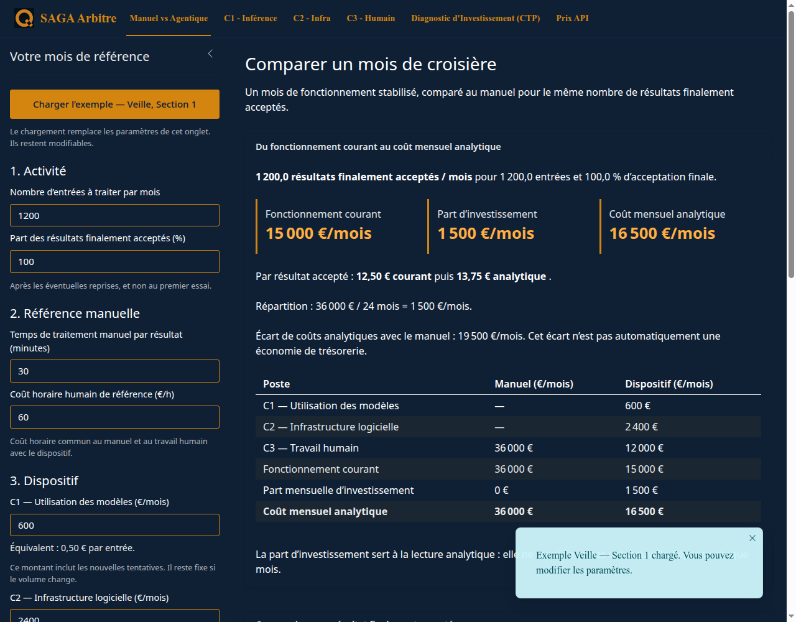

# SAGA Arbitre

Simulez les coûts d'un projet d'IA et examinez ses hypothèses avec une application **R/Shiny en français**. Six onglets permettent de comparer travail manuel et dispositif agentique, puis de détailler les coûts des modèles, de l'infrastructure et du travail humain.

Arbitre est un **compagnon gratuit et facultatif** de [SAGA-IA](https://qognito.io/formations/). Le PDF du volume 1 est autonome : aucune installation ni aucun compte Arbitre n'est nécessaire pour l'étudier. Le code de cette application est sous [licence MIT](LICENSE) ; cette licence ne couvre pas les PDF SAGA-IA payants.

> Version candidate pour la première release `v1.0.0`. Consultez les [résultats de validation](docs/validation/release-1.0.md) et la [CI](https://github.com/nucorg/app_saga_arbitre/actions) avant de choisir une version. Une plateforme n'est annoncée comme vérifiée qu'après réussite de ses contrôles.



## Installation en quelques étapes

Vous avez besoin de **R 4.5.2**, d'un navigateur récent et d'une connexion Internet pour télécharger le code et les dépendances. RStudio est facultatif. Aucune clé API, inscription Stripe ou connexion à un fournisseur de modèles n'est nécessaire : l'application calcule à partir des valeurs saisies, elle n'appelle pas de modèle d'IA.

1. Installez [R](https://cran.r-project.org/). Windows : installez aussi la version de Rtools adaptée à R si une dépendance doit être compilée. macOS : les outils de ligne de commande Xcode peuvent être nécessaires (`xcode-select --install`). Ubuntu/Debian : les compilations requièrent notamment `build-essential`, `libcurl4-openssl-dev`, `libssl-dev`, `libxml2-dev` et `libicu-dev`.
2. Téléchargez et décompressez le code depuis le bouton **Code → Download ZIP**, ou utilisez Git :

   ```sh
   git clone https://github.com/nucorg/app_saga_arbitre.git
   cd app_saga_arbitre
   ```

3. Dans R/RStudio, placez-vous dans le dossier contenant `app.R`, puis restaurez les versions des packages :

   ```r
   source("renv/activate.R")
   renv::restore(prompt = FALSE)
   ```

   La première restauration peut prendre plusieurs minutes. Acceptez l'installation de `renv` si elle est proposée. Elle utilise une bibliothèque de projet et ne requiert aucun dossier personnel de l'auteur.

4. Lancez l'application :

   ```r
   shiny::runApp(host = "127.0.0.1", port = 3847, launch.browser = TRUE)
   ```

   Au terminal, depuis ce même dossier :

   ```sh
   Rscript -e 'shiny::runApp(host="127.0.0.1", port=3847, launch.browser=TRUE)'
   ```

Ouvrez `http://127.0.0.1:3847` si le navigateur ne s'ouvre pas. Pour arrêter : bouton **Stop** de RStudio, **Échap** dans la console R ou **Ctrl+C** au terminal. L'application reste accessible uniquement sur votre ordinateur avec cette commande.

Après l'installation, les calculs et ressources de l'interface fonctionnent sans connexion Internet. Les prix API inclus sont des références datées, pas des prix récupérés automatiquement en temps réel.

## Premier exercice : comparer les coûts mensuels

Dans **Manuel vs Agentique**, cliquez sur **Charger l'exemple — Veille, Section 1**.

| Repère | Résultat attendu |
| --- | ---: |
| Volume mensuel, acceptation finale | 1 200 entrées, 100 % |
| C1 : appels aux modèles | 600 €/mois |
| C2 : infrastructure et logiciels | 2 400 €/mois |
| C3 : travail humain, 200 h × 60 € | 12 000 €/mois |
| Coût courant | **15 000 €/mois** |
| Coût analytique avec investissement réparti | **16 500 €/mois** |
| Coût analytique par résultat accepté | **13,75 €** |

Modifiez ensuite une hypothèse, observez l'effet et utilisez **Ajouter à la comparaison — session** pour conserver une variante tant que la session reste ouverte. Les paramètres complets figurent dans [le scénario versionné](data/scenarios/veille-section-1.json).

Un écart de coûts ou un solde positif ne prouve pas une économie de trésorerie. La qualité du service comparé, les hypothèses et l'utilisation effective du temps libéré restent à examiner.

## Six onglets, des reports explicites

| Onglet | Ce qu'il permet |
| --- | --- |
| Manuel vs Agentique | Comparer les coûts courants, analytiques et par résultat accepté. |
| C1 | Estimer les dépenses API et choisir le modèle à reporter. |
| C2 | Additionner six postes récurrents mensuels. Un champ vide reste inconnu. |
| C3 | Estimer revue, reprises et supervision pendant calibrage et croisière. |
| CTP | Examiner l'exploitation et l'investissement sur un horizon choisi. |
| Prix API | Modifier, importer et exporter les tarifs propres à votre session. |

Les boutons de report remplacent les valeurs concernées dans l'onglet destination. Les onglets ne restent **pas synchronisés** après une modification : reportez à nouveau si nécessaire. C1 et C2 sont en euros par mois ; C3 est exprimé en heures et valorisé au coût horaire. L'horizon du projet et la durée de répartition analytique sont distincts.

Pour le CTP, le préréglage **Veille, CTP à 6 mois** donne 108 000 € d'exploitation et 36 000 € d'investissement, soit **144 000 €** de projet. Le solde conventionnel de **+9 000 €** dépend des hypothèses du scénario ; ce n'est pas un rendement garanti.

Les [conventions détaillées](docs/reference/calculs-et-historique.md) complètent ces repères.

## Données, tarifs et vie privée

- Vos saisies et comparaisons restent dans la mémoire de votre session. Quitter la session les perd ; aucun compte ni stockage cloud n'est créé.
- Les tarifs personnalisés ne modifient jamais le catalogue livré ni la session d'un autre utilisateur.
- Dans **Prix API**, exportez votre CSV avant de quitter. À la prochaine visite, importez-le, puis cliquez sur **Appliquer à ma simulation**.
- CSV UTF-8, séparateur virgule ou point-virgule. Colonnes obligatoires : `Identifiant`, `p_in_1M`, `p_out_1M`. Facultatives : `Fournisseur`, `p_cache_1M`, `date_verification`. Les prix sont en **USD par million de jetons** ; utilisez une conversion explicite vers l'euro dans la simulation.
- Un import invalide ne remplace pas les données actives. Les identifiants doivent être uniques ; une date renseignée suit `AAAA-MM-JJ`.
- Aucun PDF payant ou journal interne n'est nécessaire à l'exécution de cette application.

## Dépannage

| Symptôme | Action |
| --- | --- |
| Package manquant | Ouvrir le bon dossier et relancer `renv::restore(prompt=FALSE)`. |
| Erreur de compilation d'un package | Installer les outils système ci-dessus ; conserver le nom du package et l'erreur pour un signalement. |
| `app.R` ou `R/…` introuvable | Vérifier `getwd()` ; travailler à la racine du dépôt décompressé. |
| Port déjà utilisé | Choisir un autre port, par exemple `port=3848`. |
| Résultat non défini | Vérifier les champs vides, unités, volume, taux d'acceptation et durées. Zéro doit être saisi explicitement. |
| Prix modifiés sans effet | Cliquer sur **Appliquer à ma simulation**, puis refaire le report nécessaire. |
| Paramètres disparus | Les sessions ne sont pas persistantes ; réimporter les tarifs exportés. |

## Tests et versions

Depuis la racine du projet, après restauration :

```sh
Rscript -e 'testthat::test_dir("tests/testthat", stop_on_failure=TRUE)'
Rscript scripts/smoke.R
```

La CI restaure le même `renv.lock` sur Linux, Windows et macOS. Les tests vérifient les calculs, valeurs invalides, six pages, reports, import/export, isolation entre sessions et intégrité du catalogue. Le contrôle de démarrage charge réellement l'application.

Pour signaler un problème, utilisez les [issues GitHub](https://github.com/nucorg/app_saga_arbitre/issues) : système, version de R, version du dépôt, étapes, résultat attendu et résultat obtenu. Fournissez un scénario fictif reproductible, sans donnée client ni secret. Le support communautaire n'inclut pas de délai contractuel ou de conseil personnalisé.

Les packages tiers gardent leurs propres licences. Le nom et les logos Qognito ne sont pas concédés comme marques par la licence MIT. Les procédures de déploiement hébergé sont réservées à la maintenance et ne sont pas requises pour installer Arbitre.

**English:** Arbitre is a free, optional simulator with a French interface. Install R, restore the project with `renv::restore()`, then run `shiny::runApp()`. No AI API key or purchase is required. The paid PDF has a separate licence.

**Español:** Arbitre es un simulador gratuito y opcional con interfaz en francés. Instale R, restaure el proyecto con `renv::restore()` y ejecute `shiny::runApp()`. No requiere clave API ni compra. El PDF de pago tiene una licencia independiente.
